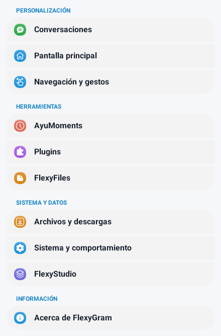
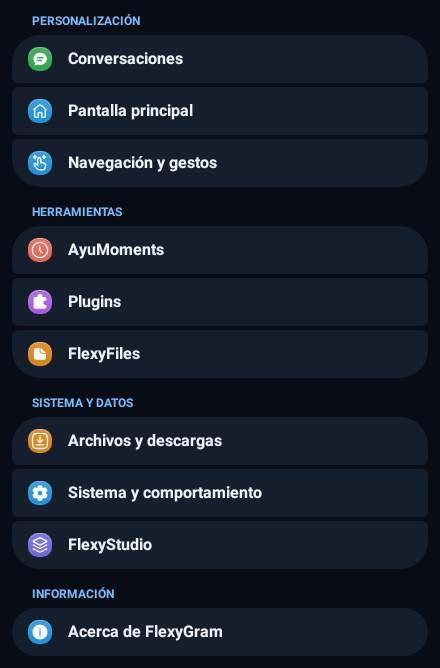

# Ajustes agrupados universales de FlexyGram

Referencia aprobada: tarjetas separadas con curvas amplias al abrir y cerrar cada sección,
esquinas suaves en el centro, iconos más pequeños y sin flechas de navegación.

## Presentación

- Primera fila: radio superior de 28 dp e inferior de 6 dp.
- Filas centrales: radio de 6 dp en las cuatro esquinas.
- Última fila: radio superior de 6 dp e inferior de 28 dp.
- Fila única: cuatro esquinas de 28 dp, limitadas naturalmente por su altura.
- Separación de 4 dp y margen horizontal de 12 dp.
- Iconos de categorías y navegación de color: 24 dp, antes 32 dp. Los iconos lineales
  de `SignatureNavigationCell` pasan de 22 a 20 dp. Las zonas táctiles no se reducen.
- Flechas de navegación retiradas; valores, interruptores, controles y destinos conservados.

Se conserva la paleta del tema claro/oscuro. Si un tema personalizado da el mismo color
al fondo y a las tarjetas, se ajusta ligeramente la superficie para que sigan distinguiéndose.
Los encabezados permanecen fuera de los grupos y usan el acento del tema.

## Cobertura

La pantalla principal conserva sus diez categorías y sus tarjetas individuales. Se corrige
el fallo que borraba sus fondos al ejecutar el bind del adaptador base. La prueba Android
ahora ejecuta ese método real, que el anfitrión anterior omitía.

El estilo se comparte entre `SignatureMatteSettingsActivity`, `BaseNekoSettingsActivity`
y `BaseNekoXSettingsActivity`: conversaciones, pantalla principal, navegación, Universal,
AyuMoments, archivos, FlexyStudio y sus controles y editores propios de ajustes.
`SettingsCardLists` aplica el mismo acabado a las pantallas de plugins, sus permisos,
información y registro de actividad, y la navegación que usa `UniversalRecyclerView`.
Los gestores externos que abren pantallas nativas ajenas a estas bases conservan sus propias
implementaciones. Las listas de chats y mensajes no reciben este estilo de ajustes.

Las agrupaciones se calculan por tipos de adaptador, incluidos los tipos locales de las
secciones combinadas; no dependen de que una cabecera o una fila vecina esté visible.
Se conservan el desplazamiento, los callbacks, la selección, el reciclado y los elementos
transparentes como estados vacíos de plugins. No se añaden preferencias ni dependencias.

## Renderizado

Se reutiliza la segmentación nativa de `RecyclerListView`, activada localmente en las listas
de ajustes. Las listas que no usan esta activación mantienen el espaciado y los radios
anteriores. El pintor conserva Paint, Path y radios; no crea blur, sombras, bitmaps ni objetos
en cada dibujo. Se ajusta también la máscara de selección de las secciones segmentadas.

## Verificación

- Suite general: `python -m pytest tests/ -q -p no:cacheprovider`.
- Geometría real de `RecyclerListView.SectionsDrawer`: pruebas de grupos, filas únicas,
  alfa y compatibilidad del modo segmentado anterior en `test_grouped_settings_cards.py`.
- Probe Android: `python tools/settings3/android/run.py --sdk-root /ruta/android-sdk --maven mvn
  --output-dir /tmp/flexy-settings-grouped-probe`.
- 15 pruebas de Canvas Android API 35 y adaptadores AndroidX, con anfitriones Telegram aislados:
  tarjetas y esquinas, temas, letras grandes, RTL, iconos pequeños, retirada de flechas,
  conservación de fondos tras el bind real, encabezados fuera de pantalla, estados
  transparentes, rutas, clics, reciclado y selección de estilos.
- Los componentes y subclases de lista probados se compilan contra API 37 en ese anfitrión.
  El RecyclerListView completo no se compila en este probe; su geometría real se extrae
  sin cambios para la prueba JVM. No equivale a compilar la aplicación.

Renderizados del contenido real de la página principal, sin barra superior, en el anfitrión
Android aislado:

No se compila APK, no se inicia GitHub Actions y no se publica esta revisión. Sigue pendiente
la aceptación visual de todas las subsecciones en un dispositivo.

Resultado comprobado: **249 pruebas generales aprobadas, 31 omitidas y 15 pruebas Android aprobadas**. El parser Java 21 acepta los 21 archivos Java de producción modificados o añadidos. `git diff --check` no presenta incidencias.
