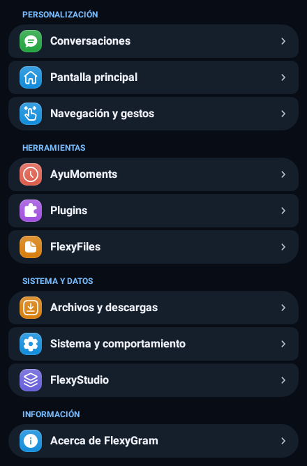
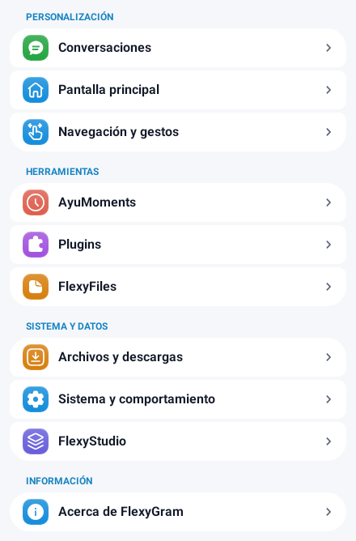

# Tarjetas de ajustes y selección visual de interfaces

Se aplica la referencia aprobada de Opexgram: filas separadas por pequeños espacios,
esquinas exteriores más redondeadas en cada grupo, encabezados con el acento del
tema e iconos sobre bases de color. Las diez categorías de FlexyGram conservan
sus destinos. Las filas crecen con letras grandes y conservan un mínimo táctil
de 48 dp; el desplazamiento sigue disponible cuando sea necesario.

Los iconos reutilizan `SettingsActivity.SettingCell.Background`, el fondo de
iconos nativo de Telegram, y sus símbolos rellenos donde corresponden. Se mantiene
la identidad de los símbolos de inicio, gestos, historial, descargas y capas.
El mismo tratamiento se aplica a las filas de navegación de ajustes existentes.
El texto, las tarjetas y los indicadores usan los colores del tema claro/oscuro.

## Conversaciones

- **Interfaz inferior:** dos tarjetas anchas, Predeterminada y Compacta. Cada una
  muestra únicamente el compositor; un toque llama al setter existente del estilo.
- **Interfaz superior:** galería horizontal con los cuatro estilos existentes:
  Clásico, Signature Adaptive, Signature Fusion y Signature Matte Portrait. Un toque
  selecciona la cabecera y se conserva la selección al recrear la pantalla.
- **Burbujas:** editor existente, con sus controles y callbacks conservados y
  separación vertical más compacta.

Las vistas previas usan los iconos, geometrías y superficies existentes. El fondo
vigente se obtiene mediante `SignatureWallpaperPreview` y se actualiza ante los
cambios de tema o fondo. Se cierran observadores y recursos al separar las vistas.
No se inicia un chat ni se carga un contacto para dibujar las tarjetas. Dibujar
una opción no escribe preferencias; únicamente el toque selecciona el estilo.
Las preferencias anteriores de tamaño/posición se conservan al cambiar de estilo.

Se mantiene Liquid Glass nativo; no se recupera el motor de blur/borde retirado.

## Validación y límites

- Suite general: **240 aprobadas y 31 omisiones opcionales**.
- Prueba Android aislada: **11 aprobadas**. Ejecuta las tarjetas e iconos reales,
  el fondo nativo de iconos, cambios claro/oscuro, texto ampliado/RTL y selección
  de presets con sus backends reales de preferencias y recreación de pantalla.
- El anfitrión Telegram y los renderizadores de los componentes dentro de la
  prueba de selección son dobles explícitos. Los componentes reales de cabecera
  y compositor se comprobaron aparte mediante compilación contra API 37 con
  dependencias de Telegram aisladas.
- No es una compilación completa ni una validación visual de los efectos GPU de
  Liquid Glass en un teléfono. No se genera APK.

Reproducción de las pruebas Android:

```bash
MAVEN_REPO_LOCAL=/tmp/flexy-m2 python tools/settings3/android/run.py \
  --sdk-root /path/to/android-sdk --output-dir /tmp/flexy-settings-probe
```

## Renderizados del inicio

Son renderizados Android del código de las tarjetas, con anfitrión y paleta
aislados. No son capturas de la APK ni ilustraciones generadas.




