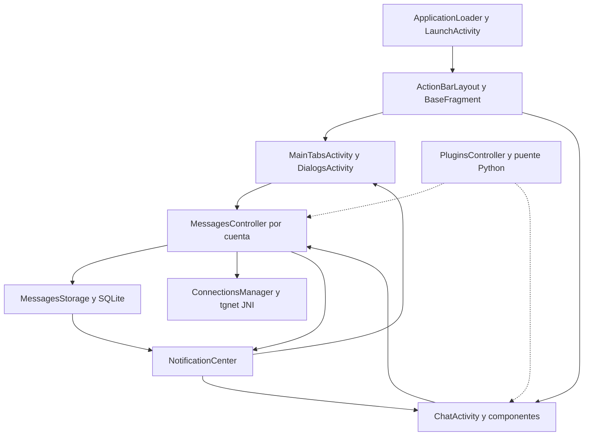

# Mapa de arquitectura Android

[Índice de auditoría](README.md). Evidencia fijada al commit `db1bea24b7b705de33f8ff8c8e174011c153cac7`.

## Organización y límites

El inventario del árbol Git contiene 27 900 rutas versionadas, incluidas 2696 `.java`, 60 `.kt`, 178 `.cpp` y 296 `.c`. Son conteos por extensión del superproyecto, incluyendo código vendorizado; no equivalen a clases propias ni incluyen archivos internos de submódulos. Hay un módulo Android de aplicación explícito, `:TMessagesProj`, y una inclusión dinámica de módulos Media3 desde el submódulo `media`. `buildSrc` es lógica de construcción, no una biblioteca de UI. Evidencia: [settings.gradle:L29](https://github.com/Jose22Yt/FlexyGram/blob/db1bea24b7b705de33f8ff8c8e174011c153cac7/settings.gradle#L29), [buildSrc/build.gradle.kts:L1](https://github.com/Jose22Yt/FlexyGram/blob/db1bea24b7b705de33f8ff8c8e174011c153cac7/buildSrc/build.gradle.kts#L1).

El diagrama resume dependencias, no pretende representar todos los callbacks ni una ejecución secuencial única.

| Capa / ubicación | Responsabilidad real y referencias | Tratamiento futuro recomendado |
| --- | --- | --- |
| `ApplicationLoader` | Contexto/Handler global e inicialización de preferencias, cuentas y plugins. [TMessagesProj/src/main/java/org/telegram/messenger/ApplicationLoader.java:L230](https://github.com/Jose22Yt/FlexyGram/blob/db1bea24b7b705de33f8ff8c8e174011c153cac7/TMessagesProj/src/main/java/org/telegram/messenger/ApplicationLoader.java#L230), [TMessagesProj/src/main/java/org/telegram/messenger/ApplicationLoader.java:L305](https://github.com/Jose22Yt/FlexyGram/blob/db1bea24b7b705de33f8ff8c8e174011c153cac7/TMessagesProj/src/main/java/org/telegram/messenger/ApplicationLoader.java#L305), [TMessagesProj/src/main/java/org/telegram/messenger/ApplicationLoader.java:L350](https://github.com/Jose22Yt/FlexyGram/blob/db1bea24b7b705de33f8ff8c8e174011c153cac7/TMessagesProj/src/main/java/org/telegram/messenger/ApplicationLoader.java#L350) | Mantener orden y evitar nuevos trabajos síncronos de inicio |
| `LaunchActivity` | Activity anfitriona, intents, restauración y back. `singleTask`, cambios de configuración y aceleración HW declarados. [TMessagesProj/src/main/AndroidManifest.xml:L109](https://github.com/Jose22Yt/FlexyGram/blob/db1bea24b7b705de33f8ff8c8e174011c153cac7/TMessagesProj/src/main/AndroidManifest.xml#L109), [TMessagesProj/src/main/AndroidManifest.xml:L418](https://github.com/Jose22Yt/FlexyGram/blob/db1bea24b7b705de33f8ff8c8e174011c153cac7/TMessagesProj/src/main/AndroidManifest.xml#L418), [TMessagesProj/src/main/java/org/telegram/ui/LaunchActivity.java:L432](https://github.com/Jose22Yt/FlexyGram/blob/db1bea24b7b705de33f8ff8c8e174011c153cac7/TMessagesProj/src/main/java/org/telegram/ui/LaunchActivity.java#L432) | Integrar por contratos existentes; no reemplazar la Activity |
| `INavigationLayout` / `ActionBarLayout` | Stack, contenedores delantero/trasero, transiciones, gestos y preview. La fábrica retorna ActionBarLayout. [TMessagesProj/src/main/java/org/telegram/ui/ActionBar/INavigationLayout.java:L86](https://github.com/Jose22Yt/FlexyGram/blob/db1bea24b7b705de33f8ff8c8e174011c153cac7/TMessagesProj/src/main/java/org/telegram/ui/ActionBar/INavigationLayout.java#L86) | Ruta crítica a preservar hasta medir |
| `BaseFragment` | Clase propia de pantalla con argumentos, cuenta, vista y callbacks. No es `androidx.fragment.app.Fragment`. [TMessagesProj/src/main/java/org/telegram/ui/ActionBar/BaseFragment.java:L81](https://github.com/Jose22Yt/FlexyGram/blob/db1bea24b7b705de33f8ff8c8e174011c153cac7/TMessagesProj/src/main/java/org/telegram/ui/ActionBar/BaseFragment.java#L81), [TMessagesProj/src/main/java/org/telegram/ui/ActionBar/BaseFragment.java:L268](https://github.com/Jose22Yt/FlexyGram/blob/db1bea24b7b705de33f8ff8c8e174011c153cac7/TMessagesProj/src/main/java/org/telegram/ui/ActionBar/BaseFragment.java#L268) | Respetar create/destroy y visibilidad; evitar wrappers de ciclo de vida incompatibles |
| `MainTabsActivity` / `ViewPagerActivity` | Pantallas raíz, tabs y estados de páginas en SparseArray. [TMessagesProj/src/main/java/org/telegram/ui/MainTabsActivity.java:L109](https://github.com/Jose22Yt/FlexyGram/blob/db1bea24b7b705de33f8ff8c8e174011c153cac7/TMessagesProj/src/main/java/org/telegram/ui/MainTabsActivity.java#L109), [TMessagesProj/src/main/java/org/telegram/ui/ViewPagerActivity.java:L30](https://github.com/Jose22Yt/FlexyGram/blob/db1bea24b7b705de33f8ff8c8e174011c153cac7/TMessagesProj/src/main/java/org/telegram/ui/ViewPagerActivity.java#L30) | Extender tabs existentes; no introducir otro pager sobre el actual |
| `DialogsActivity` / `DialogsAdapter` / `DialogCell` | Lista, selección, búsqueda, filtros, clic y preview. [TMessagesProj/src/main/java/org/telegram/ui/DialogsActivity.java:L4592](https://github.com/Jose22Yt/FlexyGram/blob/db1bea24b7b705de33f8ff8c8e174011c153cac7/TMessagesProj/src/main/java/org/telegram/ui/DialogsActivity.java#L4592), [TMessagesProj/src/main/java/org/telegram/ui/Adapters/DialogsAdapter.java:L646](https://github.com/Jose22Yt/FlexyGram/blob/db1bea24b7b705de33f8ff8c8e174011c153cac7/TMessagesProj/src/main/java/org/telegram/ui/Adapters/DialogsAdapter.java#L646) | Decoración e iconos por políticas acotadas; conservar adaptadores y reciclado |
| `ChatActivity` / `ChatActivityAdapter` / `ChatMessageCell` | Historial, mensajes, teclado, reacciones, selección y dibujo de burbujas. [TMessagesProj/src/main/java/org/telegram/ui/ChatActivity.java:L4029](https://github.com/Jose22Yt/FlexyGram/blob/db1bea24b7b705de33f8ff8c8e174011c153cac7/TMessagesProj/src/main/java/org/telegram/ui/ChatActivity.java#L4029), [TMessagesProj/src/main/java/org/telegram/ui/ChatActivity.java:L39961](https://github.com/Jose22Yt/FlexyGram/blob/db1bea24b7b705de33f8ff8c8e174011c153cac7/TMessagesProj/src/main/java/org/telegram/ui/ChatActivity.java#L39961), [TMessagesProj/src/main/java/org/telegram/ui/Cells/ChatMessageCell.java:L20684](https://github.com/Jose22Yt/FlexyGram/blob/db1bea24b7b705de33f8ff8c8e174011c153cac7/TMessagesProj/src/main/java/org/telegram/ui/Cells/ChatMessageCell.java#L20684) | Cambios pequeños y revisados; no duplicar toda la clase para una interfaz compacta |
| `MessagesController`, `AccountInstance`, `UserConfig` | Modelo y control por cuenta, caché de entidades y carga de mensajes. [TMessagesProj/src/main/java/org/telegram/messenger/MessagesController.java:L11811](https://github.com/Jose22Yt/FlexyGram/blob/db1bea24b7b705de33f8ff8c8e174011c153cac7/TMessagesProj/src/main/java/org/telegram/messenger/MessagesController.java#L11811), [TMessagesProj/src/main/java/org/telegram/messenger/UserConfig.java:L1](https://github.com/Jose22Yt/FlexyGram/blob/db1bea24b7b705de33f8ff8c8e174011c153cac7/TMessagesProj/src/main/java/org/telegram/messenger/UserConfig.java#L1) | Mantener separación de cuentas y semántica de carga |
| `MessagesStorage` / `DispatchQueue` | SQLite y cola de almacenamiento por cuenta; Handler/Looper para trabajo serial. [TMessagesProj/src/main/java/org/telegram/messenger/MessagesStorage.java:L249](https://github.com/Jose22Yt/FlexyGram/blob/db1bea24b7b705de33f8ff8c8e174011c153cac7/TMessagesProj/src/main/java/org/telegram/messenger/MessagesStorage.java#L249), [TMessagesProj/src/main/java/org/telegram/messenger/DispatchQueue.java:L19](https://github.com/Jose22Yt/FlexyGram/blob/db1bea24b7b705de33f8ff8c8e174011c153cac7/TMessagesProj/src/main/java/org/telegram/messenger/DispatchQueue.java#L19) | No trasladar indiscriminadamente estas operaciones al UI ni cambiar su serialización |
| `ConnectionsManager` / JNI | Solicitudes y callbacks de red, puente hacia tgnet C++. [TMessagesProj/src/main/java/org/telegram/tgnet/ConnectionsManager.java:L675](https://github.com/Jose22Yt/FlexyGram/blob/db1bea24b7b705de33f8ff8c8e174011c153cac7/TMessagesProj/src/main/java/org/telegram/tgnet/ConnectionsManager.java#L675), [TMessagesProj/jni/TgNetWrapper.cpp:L1](https://github.com/Jose22Yt/FlexyGram/blob/db1bea24b7b705de33f8ff8c8e174011c153cac7/TMessagesProj/jni/TgNetWrapper.cpp#L1) | Preservar MTProto, cancelación por GUID y seguridad |
| `NotificationCenter` | Eventos por cuenta/globales y postergación durante animaciones. [TMessagesProj/src/main/java/org/telegram/messenger/NotificationCenter.java:L605](https://github.com/Jose22Yt/FlexyGram/blob/db1bea24b7b705de33f8ff8c8e174011c153cac7/TMessagesProj/src/main/java/org/telegram/messenger/NotificationCenter.java#L605), [TMessagesProj/src/main/java/org/telegram/messenger/NotificationCenter.java:L679](https://github.com/Jose22Yt/FlexyGram/blob/db1bea24b7b705de33f8ff8c8e174011c153cac7/TMessagesProj/src/main/java/org/telegram/messenger/NotificationCenter.java#L679) | Mantener pares registro/desregistro y finalizar tokens de animación |
| `ImageLoader` / `ImageReceiver` | Cachés y colas de imágenes, adjuntar/desadjuntar y cancelación. [TMessagesProj/src/main/java/org/telegram/messenger/ImageLoader.java:L119](https://github.com/Jose22Yt/FlexyGram/blob/db1bea24b7b705de33f8ff8c8e174011c153cac7/TMessagesProj/src/main/java/org/telegram/messenger/ImageLoader.java#L119), [TMessagesProj/src/main/java/org/telegram/messenger/ImageReceiver.java:L1121](https://github.com/Jose22Yt/FlexyGram/blob/db1bea24b7b705de33f8ff8c8e174011c153cac7/TMessagesProj/src/main/java/org/telegram/messenger/ImageReceiver.java#L1121) | Reutilizar; no crear descargas/decodificaciones paralelas por cada celda |
| `MediaController` / Media3 / `Md3Player` | Reproducción central y presentaciones propias de Exteraless; selector entre PlayerSheet y AudioPlayerAlert. [TMessagesProj/src/main/java/app/exteraless/player/Md3Player.java:L16](https://github.com/Jose22Yt/FlexyGram/blob/db1bea24b7b705de33f8ff8c8e174011c153cac7/TMessagesProj/src/main/java/app/exteraless/player/Md3Player.java#L16) | Una fuente de reproducción; FlexyGram puede cambiar presentación, no añadir otro player |
| `Theme`, `GlassEngine`, `blur3` | Colores, drawables, captura, invalidación y RenderNode/RenderEffect según ruta API. [TMessagesProj/src/main/java/org/telegram/utils/glass/GlassEngine.java:L52](https://github.com/Jose22Yt/FlexyGram/blob/db1bea24b7b705de33f8ff8c8e174011c153cac7/TMessagesProj/src/main/java/org/telegram/utils/glass/GlassEngine.java#L52), [TMessagesProj/src/main/java/org/telegram/ui/Components/blur3/source/BlurredBackgroundSourceRenderNode.java:L62](https://github.com/Jose22Yt/FlexyGram/blob/db1bea24b7b705de33f8ff8c8e174011c153cac7/TMessagesProj/src/main/java/org/telegram/ui/Components/blur3/source/BlurredBackgroundSourceRenderNode.java#L62) | Reutilizar mecanismos de invalidación; validar fallback y modo oscuro |
| `app.exteraless.*` | Apariencia, ajustes, player, pillstack, iconos, cámara, feed, plugins y otros controladores | Es organización por paquetes, no módulos Gradle independientes |

## Lenguajes, nativos y recursos

Java concentra UI y núcleo heredado. Kotlin incorpora configuraciones y extensiones, además del plugin Gradle de metadatos Lottie. La presencia de una clase bajo `com.exteragram.*` puede representar una fachada de compatibilidad, no un segundo motor completo: por ejemplo `app.exteraless.plugins.PluginsController` hereda la API de compatibilidad. [TMessagesProj/src/main/java/app/exteraless/plugins/PluginsController.java:L54](https://github.com/Jose22Yt/FlexyGram/blob/db1bea24b7b705de33f8ff8c8e174011c153cac7/TMessagesProj/src/main/java/app/exteraless/plugins/PluginsController.java#L54).

El código nativo mezcla red tgnet, SQLite, imagen/audio, VoIP/WebRTC, ffmpeg, tlottie, tde2e, Prisma y wallet. CMake importa archivos estáticos y enlaza puentes JNI. El estándar global es C++17; wallet usa C++20 en targets concretos. No cambiar ABI, símbolos JNI ni flags globales como una supuesta optimización de UI. [TMessagesProj/jni/CMakeLists.txt:L1](https://github.com/Jose22Yt/FlexyGram/blob/db1bea24b7b705de33f8ff8c8e174011c153cac7/TMessagesProj/jni/CMakeLists.txt#L1), [TMessagesProj/jni/CMakeLists.txt:L90](https://github.com/Jose22Yt/FlexyGram/blob/db1bea24b7b705de33f8ff8c8e174011c153cac7/TMessagesProj/jni/CMakeLists.txt#L90), [TMessagesProj/jni/CMakeLists.txt:L128](https://github.com/Jose22Yt/FlexyGram/blob/db1bea24b7b705de33f8ff8c8e174011c153cac7/TMessagesProj/jni/CMakeLists.txt#L128), [TMessagesProj/jni/CMakeLists.txt:L173](https://github.com/Jose22Yt/FlexyGram/blob/db1bea24b7b705de33f8ff8c8e174011c153cac7/TMessagesProj/jni/CMakeLists.txt#L173).

La base ya incorpora extensiones de player, pillstack, apariencia, feed y plugins. No es un núcleo Telegram vacío, y no debe atribuirse su autoría a FlexyGram ni duplicarlas al añadir funciones propias. El tamaño de estas clases, por sí solo, tampoco demuestra lentitud.

Existe una copia de `androidx.recyclerview.widget` dentro del código y se excluye el artefacto externo `androidx.recyclerview:recyclerview` en Gradle. Añadirlo de nuevo puede duplicar o alterar clases/semántica. [TMessagesProj/build.gradle:L365](https://github.com/Jose22Yt/FlexyGram/blob/db1bea24b7b705de33f8ff8c8e174011c153cac7/TMessagesProj/build.gradle#L365), [TMessagesProj/src/main/java/androidx/recyclerview/widget/RecyclerView.java:L1](https://github.com/Jose22Yt/FlexyGram/blob/db1bea24b7b705de33f8ff8c8e174011c153cac7/TMessagesProj/src/main/java/androidx/recyclerview/widget/RecyclerView.java#L1).

## Estados y ciclo de vida

1. Estado persistido: `SharedConfig`, `UserConfig`, configuraciones Neko/Na/OpenExtera/Appearance y bases de datos por cuenta. No hay un único store reactivo central.
2. Estado de pantalla: argumentos Bundle, `BaseFragment.fragmentView`, stack, página del ViewPager, modos de chat/preview y estado del teclado.
3. Estado de navegación: flags de transición, gesture tracking y back predictivo. Su limpieza forma parte de la corrección funcional.
4. `BaseFragment.onFragmentDestroy()` cancela solicitudes/tareas por GUID; `ChatActivity.onFragmentDestroy()` libera menús, reacciones, listeners y callbacks; MainTabs elimina sus observadores. [TMessagesProj/src/main/java/org/telegram/ui/ActionBar/BaseFragment.java:L525](https://github.com/Jose22Yt/FlexyGram/blob/db1bea24b7b705de33f8ff8c8e174011c153cac7/TMessagesProj/src/main/java/org/telegram/ui/ActionBar/BaseFragment.java#L525), [TMessagesProj/src/main/java/org/telegram/ui/ChatActivity.java:L3748](https://github.com/Jose22Yt/FlexyGram/blob/db1bea24b7b705de33f8ff8c8e174011c153cac7/TMessagesProj/src/main/java/org/telegram/ui/ChatActivity.java#L3748), [TMessagesProj/src/main/java/org/telegram/ui/MainTabsActivity.java:L1234](https://github.com/Jose22Yt/FlexyGram/blob/db1bea24b7b705de33f8ff8c8e174011c153cac7/TMessagesProj/src/main/java/org/telegram/ui/MainTabsActivity.java#L1234).
5. `LaunchActivity` guarda argumentos en el estado Android. Hay que validar restauración con process death, multicuenta, modo oscuro y orientación; manejar `configChanges` no prueba restauración correcta. [TMessagesProj/src/main/java/org/telegram/ui/LaunchActivity.java:L8557](https://github.com/Jose22Yt/FlexyGram/blob/db1bea24b7b705de33f8ff8c8e174011c153cac7/TMessagesProj/src/main/java/org/telegram/ui/LaunchActivity.java#L8557).

La vista del fragmento se crea si es nula y, si existe, se retira de su padre para reinsertarla. Hay reutilización de contenedores, pero no se ha encontrado una garantía de pool global que evite crear un nuevo ChatActivity en cada apertura. [TMessagesProj/src/main/java/org/telegram/ui/ActionBar/ActionBarLayout.java:L2497](https://github.com/Jose22Yt/FlexyGram/blob/db1bea24b7b705de33f8ff8c8e174011c153cac7/TMessagesProj/src/main/java/org/telegram/ui/ActionBar/ActionBarLayout.java#L2497).

## Plugins y configuración

`ApplicationLoader` inicializa PluginsController; este dispone de un executor de archivos y PythonPluginsEngine de otro executor para inicio/trabajos del motor. El SDK Python está en `src/main/python`: `base_plugin.py`, `extera_utils`, `elyx_runtime` y utilidades UI. Hay permisos, grants, runtime owner, filtros de sinks, hooks Aliuhook/LSPlant y watchdog. Son controles existentes, no una prueba de aislamiento perfecto o seguridad frente a todo plugin. [TMessagesProj/src/main/java/app/exteraless/plugins/PluginsController.java:L108](https://github.com/Jose22Yt/FlexyGram/blob/db1bea24b7b705de33f8ff8c8e174011c153cac7/TMessagesProj/src/main/java/app/exteraless/plugins/PluginsController.java#L108), [TMessagesProj/src/main/java/app/exteraless/plugins/PythonPluginsEngine.java:L114](https://github.com/Jose22Yt/FlexyGram/blob/db1bea24b7b705de33f8ff8c8e174011c153cac7/TMessagesProj/src/main/java/app/exteraless/plugins/PythonPluginsEngine.java#L114), [TMessagesProj/src/main/java/app/exteraless/plugins/PluginPermissions.java:L1](https://github.com/Jose22Yt/FlexyGram/blob/db1bea24b7b705de33f8ff8c8e174011c153cac7/TMessagesProj/src/main/java/app/exteraless/plugins/PluginPermissions.java#L1), [TMessagesProj/src/main/python/extera_utils/plugin_loader.py:L1](https://github.com/Jose22Yt/FlexyGram/blob/db1bea24b7b705de33f8ff8c8e174011c153cac7/TMessagesProj/src/main/python/extera_utils/plugin_loader.py#L1).

Hooks síncronos y callbacks UI requieren presupuestos medidos; las funciones estructurales de FlexyGram deberían ser nativas y no una colección de hooks globales. Mantener compatibilidad, limpieza y modo seguro del motor sin agregar otra capa de interceptores.

`ConfigItem` guarda valores en memoria y persiste mediante `SharedPreferences.Editor.apply()`. Esto no vuelve gratuitos serialización, carga inicial o invalidaciones. AppearanceConfig reutiliza opciones existentes y solo introduce claves propias donde faltan equivalentes; es un patrón útil para evitar ajustes duplicados. [TMessagesProj/src/main/java/tw/nekomimi/nekogram/config/ConfigItem.java:L129](https://github.com/Jose22Yt/FlexyGram/blob/db1bea24b7b705de33f8ff8c8e174011c153cac7/TMessagesProj/src/main/java/tw/nekomimi/nekogram/config/ConfigItem.java#L129), [TMessagesProj/src/main/kotlin/app/exteraless/appearance/AppearanceConfig.kt:L13](https://github.com/Jose22Yt/FlexyGram/blob/db1bea24b7b705de33f8ff8c8e174011c153cac7/TMessagesProj/src/main/kotlin/app/exteraless/appearance/AppearanceConfig.kt#L13).

## Arquitectura futura propuesta — no implementada

Comenzar con paquetes lógicos `app.flexygram.*` dentro de la aplicación existente. Extraer módulos Gradle solo si una frontera estable y una necesidad real lo justifican; no incorporar un framework DI o una reescritura Compose por defecto.

| Área propuesta | Contrato y punto de integración | Controles |
| --- | --- | --- |
| `config` | Snapshot de preferencias, defaults y migraciones; adaptador a ConfigItem existente | Cambios emiten invalidación concreta, sin lectura de disco en draw/bind |
| `appearance` | Crystal Pearl como paleta, formas y política de recursos sobre Theme | Cachés por tema/densidad/tamaño; fallback sólido; claro/oscuro |
| `mainui` | Controlador de header/tabs junto a MainTabsUiHelper y MainTabsActivity | Sin recrear lista ni capturar pantalla continuamente |
| `chatui` | Política de geometría del header/composer y márgenes/insets; delegados acotados | Mantener tres piezas si el diseño se aprueba después; probar grupos, bots, canales, teclado y última burbuja |
| `bubbles` | Proveedor de contorno/color apoyado en el dibujo existente de mensajes | Cachés acotadas, invalidación al cambiar configuración; no procesar recursos por fotograma |
| `icons` | Resolución de recursos y tamaños sobre sistema de iconos actual | Sin reflexión por icono ni decodificación en cada bind |
| `navigationbar` | Un controlador de barra adaptable vinculado a pager e insets existentes | No otra navegación ni segundo estado seleccionado |
| `settings` | Pantallas nativas con claves únicas, vistas previas representativas y valores explícitos | Vista previa suspendida cuando no es visible; restaurar defaults |
| `mediaui` | Presentación enlazada a MediaController/Md3Player | Un solo propietario de reproducción; listeners ligados a visibilidad |
| `motion` | Políticas locales, opt-in, de transiciones sobre contratos existentes | Nada global hasta medir; cancel/end idempotentes y pruebas de interrupción |
| `diagnostics` | Escenarios, metadatos de runs y exportación local de resultados | Instrumentación apagada en uso normal; medir su propio overhead |

PillStackController muestra ya un patrón de attach/detach y versión de layout que permite reutilizar la vista sin reconstruir si nada cambió. Es un ejemplo concreto a estudiar, no una orden de copiarlo a cada pantalla. [TMessagesProj/src/main/java/app/exteraless/pillstack/PillStackController.java:L35](https://github.com/Jose22Yt/FlexyGram/blob/db1bea24b7b705de33f8ff8c8e174011c153cac7/TMessagesProj/src/main/java/app/exteraless/pillstack/PillStackController.java#L35).

Regla de integración: una función por PR, apagado por defecto durante comparación, misma base/compilación/dataset, validación de estabilidad y respuesta antes del diseño. No activar varios cambios para luego intentar adivinar su coste.
