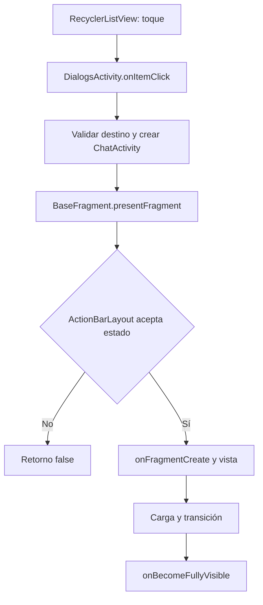

# Navegación, eventos táctiles y fluidez

[Índice](README.md). Análisis estático; todos los tiempos de código citados son parámetros, no mediciones.

## Ruta de apertura normal

- DialogsActivity configura clic inmediato para la lista principal y conecta el listener a su `onItemClick`. RecyclerListView sigue manejando pressed state, doble toque y long press; inmediato no significa que cualquier evento, incluso el de otra pantalla, se procese siempre. [TMessagesProj/src/main/java/org/telegram/ui/DialogsActivity.java:L4322](https://github.com/Jose22Yt/FlexyGram/blob/db1bea24b7b705de33f8ff8c8e174011c153cac7/TMessagesProj/src/main/java/org/telegram/ui/DialogsActivity.java#L4322), [TMessagesProj/src/main/java/org/telegram/ui/DialogsActivity.java:L4595](https://github.com/Jose22Yt/FlexyGram/blob/db1bea24b7b705de33f8ff8c8e174011c153cac7/TMessagesProj/src/main/java/org/telegram/ui/DialogsActivity.java#L4595), [TMessagesProj/src/main/java/org/telegram/ui/DialogsActivity.java:L8151](https://github.com/Jose22Yt/FlexyGram/blob/db1bea24b7b705de33f8ff8c8e174011c153cac7/TMessagesProj/src/main/java/org/telegram/ui/DialogsActivity.java#L8151), [TMessagesProj/src/main/java/org/telegram/ui/Components/RecyclerListView.java:L1102](https://github.com/Jose22Yt/FlexyGram/blob/db1bea24b7b705de33f8ff8c8e174011c153cac7/TMessagesProj/src/main/java/org/telegram/ui/Components/RecyclerListView.java#L1102).
- Se comprueba `MessagesController.checkCanOpenChat`, se construyen argumentos y se crea ChatActivity; hay ramas distintas para foros/topics, búsqueda, comunidades y selección. [TMessagesProj/src/main/java/org/telegram/ui/DialogsActivity.java:L8410](https://github.com/Jose22Yt/FlexyGram/blob/db1bea24b7b705de33f8ff8c8e174011c153cac7/TMessagesProj/src/main/java/org/telegram/ui/DialogsActivity.java#L8410), [TMessagesProj/src/main/java/org/telegram/ui/DialogsActivity.java:L8439](https://github.com/Jose22Yt/FlexyGram/blob/db1bea24b7b705de33f8ff8c8e174011c153cac7/TMessagesProj/src/main/java/org/telegram/ui/DialogsActivity.java#L8439).
- `BaseFragment.presentFragment()` delega en parentLayout; `ActionBarLayout.presentFragment()` comprueba estados y llama `onFragmentCreate()` de forma síncrona antes de crear/reutilizar la vista. [TMessagesProj/src/main/java/org/telegram/ui/ActionBar/BaseFragment.java:L683](https://github.com/Jose22Yt/FlexyGram/blob/db1bea24b7b705de33f8ff8c8e174011c153cac7/TMessagesProj/src/main/java/org/telegram/ui/ActionBar/BaseFragment.java#L683), [TMessagesProj/src/main/java/org/telegram/ui/ActionBar/ActionBarLayout.java:L2438](https://github.com/Jose22Yt/FlexyGram/blob/db1bea24b7b705de33f8ff8c8e174011c153cac7/TMessagesProj/src/main/java/org/telegram/ui/ActionBar/ActionBarLayout.java#L2438).
- `ChatActivity.firstLoadMessages()` solicita historial; MessagesController elige caché/SQLite o red. Eso no implica que todo el arranque sea asíncrono: cargar entidades no presentes en memoria usa latches en onFragmentCreate. [TMessagesProj/src/main/java/org/telegram/ui/ChatActivity.java:L3643](https://github.com/Jose22Yt/FlexyGram/blob/db1bea24b7b705de33f8ff8c8e174011c153cac7/TMessagesProj/src/main/java/org/telegram/ui/ChatActivity.java#L3643), [TMessagesProj/src/main/java/org/telegram/messenger/MessagesController.java:L11815](https://github.com/Jose22Yt/FlexyGram/blob/db1bea24b7b705de33f8ff8c8e174011c153cac7/TMessagesProj/src/main/java/org/telegram/messenger/MessagesController.java#L11815), [TMessagesProj/src/main/java/org/telegram/ui/ChatActivity.java:L3104](https://github.com/Jose22Yt/FlexyGram/blob/db1bea24b7b705de33f8ff8c8e174011c153cac7/TMessagesProj/src/main/java/org/telegram/ui/ChatActivity.java#L3104).
- Los resultados actualizan la UI mediante notificaciones; hay rutas que llaman `resumeDelayedFragmentAnimation()`. No todos los modos toman la misma rama. [TMessagesProj/src/main/java/org/telegram/ui/ChatActivity.java:L22038](https://github.com/Jose22Yt/FlexyGram/blob/db1bea24b7b705de33f8ff8c8e174011c153cac7/TMessagesProj/src/main/java/org/telegram/ui/ChatActivity.java#L22038), [TMessagesProj/src/main/java/org/telegram/ui/ChatActivity.java:L22149](https://github.com/Jose22Yt/FlexyGram/blob/db1bea24b7b705de33f8ff8c8e174011c153cac7/TMessagesProj/src/main/java/org/telegram/ui/ChatActivity.java#L22149), [TMessagesProj/src/main/java/org/telegram/ui/ChatActivity.java:L23390](https://github.com/Jose22Yt/FlexyGram/blob/db1bea24b7b705de33f8ff8c8e174011c153cac7/TMessagesProj/src/main/java/org/telegram/ui/ChatActivity.java#L23390).

### Esperas síncronas concretas

En ausencia de chat, usuario o chat cifrado en caché, onFragmentCreate publica una consulta en storageQueue y llama `await()` sin timeout. Hay cuatro bloques en líneas 3106–3113, 3145–3151, 3182–3188 y 3200–3206. La existencia de esa espera es un hecho. Su frecuencia y duración, una saturación de la cola o un posible camino excepcional que no libere el latch requieren evaluación. No se ha demostrado deadlock ni ANR. Conservar la semántica de datos: eliminar la espera sin resolver disponibilidad/estado podría introducir fallos funcionales.

## Atrás, gestos e interacciones interrumpidas

| Ruta | Código y comportamiento | Pendiente |
| --- | --- | --- |
| Botón Atrás | LaunchActivity filtra overlays/pantallas y delega en ActionBarLayout. El fragmento puede consumir el back. [TMessagesProj/src/main/java/org/telegram/ui/LaunchActivity.java:L8565](https://github.com/Jose22Yt/FlexyGram/blob/db1bea24b7b705de33f8ff8c8e174011c153cac7/TMessagesProj/src/main/java/org/telegram/ui/LaunchActivity.java#L8565), [TMessagesProj/src/main/java/org/telegram/ui/ChatActivity.java:L37101](https://github.com/Jose22Yt/FlexyGram/blob/db1bea24b7b705de33f8ff8c8e174011c153cac7/TMessagesProj/src/main/java/org/telegram/ui/ChatActivity.java#L37101) | Probar teclado, selección, adjuntos, reacciones, reproductor y sheets |
| Swipe interno | onTouchEvent usa tracking, pointer id, velocidad, umbral horizontal de 0.15 cm y relación dx/dy. Solo avanza si estado y fragmento permiten deslizar. [TMessagesProj/src/main/java/org/telegram/ui/ActionBar/ActionBarLayout.java:L1515](https://github.com/Jose22Yt/FlexyGram/blob/db1bea24b7b705de33f8ff8c8e174011c153cac7/TMessagesProj/src/main/java/org/telegram/ui/ActionBar/ActionBarLayout.java#L1515) | Probar CANCEL, varios dedos, scroll horizontal anidado y edge gestures |
| Back predictivo | LaunchActivity registra callbacks por nivel API y delega start/progress/invoked. [TMessagesProj/src/main/java/org/telegram/ui/LaunchActivity.java:L799](https://github.com/Jose22Yt/FlexyGram/blob/db1bea24b7b705de33f8ff8c8e174011c153cac7/TMessagesProj/src/main/java/org/telegram/ui/LaunchActivity.java#L799) | Android 17/HyperOS real, cancelar y completar repetidamente |
| Interrumpir back | onBackStarted termina un `backAnimator` existente si puede y vuelve a comprobar flags. Esto es un caso específico, no cancelación global. [TMessagesProj/src/main/java/org/telegram/ui/ActionBar/ActionBarLayout.java:L1784](https://github.com/Jose22Yt/FlexyGram/blob/db1bea24b7b705de33f8ff8c8e174011c153cac7/TMessagesProj/src/main/java/org/telegram/ui/ActionBar/ActionBarLayout.java#L1784) | Reentrancia, contador de stack y estado de contenedores |
| Cierre normal | closeLastFragment retorna si hay transición/tracking/animación en determinados estados. [TMessagesProj/src/main/java/org/telegram/ui/ActionBar/ActionBarLayout.java:L3101](https://github.com/Jose22Yt/FlexyGram/blob/db1bea24b7b705de33f8ff8c8e174011c153cac7/TMessagesProj/src/main/java/org/telegram/ui/ActionBar/ActionBarLayout.java#L3101) | Contabilizar intentos de cierre rechazados frente a aceptados |
| Finalización | onSlideAnimationEnd limpia flags/transforms; incluye guardia de stack pequeño. onAnimationEndCheck cancela callbacks y finaliza apertura/cierre. [TMessagesProj/src/main/java/org/telegram/ui/ActionBar/ActionBarLayout.java:L1365](https://github.com/Jose22Yt/FlexyGram/blob/db1bea24b7b705de33f8ff8c8e174011c153cac7/TMessagesProj/src/main/java/org/telegram/ui/ActionBar/ActionBarLayout.java#L1365), [TMessagesProj/src/main/java/org/telegram/ui/ActionBar/ActionBarLayout.java:L2058](https://github.com/Jose22Yt/FlexyGram/blob/db1bea24b7b705de33f8ff8c8e174011c153cac7/TMessagesProj/src/main/java/org/telegram/ui/ActionBar/ActionBarLayout.java#L2058) | Probar ciclo de vida y finalizaciones múltiples; guardias no prueban ausencia de carreras |

Los métodos de aceptación no mantienen una cola universal de toques pendientes en el código inspeccionado: varias rutas simplemente retornan. No inferir que una función nueva puede añadir un bloqueo sin afectar la experiencia. Tampoco retirar esos controles sin analizar su protección frente a reentrancia.

`ViewPagerFixed` tiene un ValueAnimator `manualScrolling` privado, cancela el anterior en cierta navegación manual y bloquea algunos gestos mientras existe. Ampliar mediante API pública; acceder al campo directamente puede romper encapsulamiento y compatibilidad. [TMessagesProj/src/main/java/org/telegram/ui/Components/ViewPagerFixed.java:L219](https://github.com/Jose22Yt/FlexyGram/blob/db1bea24b7b705de33f8ff8c8e174011c153cac7/TMessagesProj/src/main/java/org/telegram/ui/Components/ViewPagerFixed.java#L219), [TMessagesProj/src/main/java/org/telegram/ui/Components/ViewPagerFixed.java:L520](https://github.com/Jose22Yt/FlexyGram/blob/db1bea24b7b705de33f8ff8c8e174011c153cac7/TMessagesProj/src/main/java/org/telegram/ui/Components/ViewPagerFixed.java#L520).

## Transiciones y reloj

Hay varias familias coexistentes, no un único motor:

- SpringAnimation para el modo spring; callbacks de progreso modifican traslaciones, escala, alfa y colores. El final compara identidad con la animación vigente antes de limpiar. [TMessagesProj/src/main/java/org/telegram/ui/ActionBar/ActionBarLayout.java:L2190](https://github.com/Jose22Yt/FlexyGram/blob/db1bea24b7b705de33f8ff8c8e174011c153cac7/TMessagesProj/src/main/java/org/telegram/ui/ActionBar/ActionBarLayout.java#L2190).
- Alternativa por Runnable en UI: calcula dt con nanoTime, limita ciertos intervalos a 18 ms y usa duración nominal 150 ms, o 190 ms para apertura preview. `runOnUIThread` usa Handler.post/postDelayed; esta rama no es un frame clock dedicado ni prueba de sincronización directa con vsync. [TMessagesProj/src/main/java/org/telegram/ui/ActionBar/ActionBarLayout.java:L2306](https://github.com/Jose22Yt/FlexyGram/blob/db1bea24b7b705de33f8ff8c8e174011c153cac7/TMessagesProj/src/main/java/org/telegram/ui/ActionBar/ActionBarLayout.java#L2306), [TMessagesProj/src/main/java/org/telegram/messenger/AndroidUtilities.java:L2983](https://github.com/Jose22Yt/FlexyGram/blob/db1bea24b7b705de33f8ff8c8e174011c153cac7/TMessagesProj/src/main/java/org/telegram/messenger/AndroidUtilities.java#L2983).
- AnimatorSet/ObjectAnimator para otras rutas, back y temas; `onCustomTransitionAnimation` permite transiciones por fragmento. Las duraciones de 200 ms que aparecen no describen todas las aperturas. [TMessagesProj/src/main/java/org/telegram/ui/ActionBar/ActionBarLayout.java:L2670](https://github.com/Jose22Yt/FlexyGram/blob/db1bea24b7b705de33f8ff8c8e174011c153cac7/TMessagesProj/src/main/java/org/telegram/ui/ActionBar/ActionBarLayout.java#L2670), [TMessagesProj/src/main/java/org/telegram/ui/ActionBar/ActionBarLayout.java:L2711](https://github.com/Jose22Yt/FlexyGram/blob/db1bea24b7b705de33f8ff8c8e174011c153cac7/TMessagesProj/src/main/java/org/telegram/ui/ActionBar/ActionBarLayout.java#L2711), [TMessagesProj/src/main/java/org/telegram/ui/ActionBar/ActionBarLayout.java:L3641](https://github.com/Jose22Yt/FlexyGram/blob/db1bea24b7b705de33f8ff8c8e174011c153cac7/TMessagesProj/src/main/java/org/telegram/ui/ActionBar/ActionBarLayout.java#L3641).
- Apertura diferida: `ChatActivity.needDelayOpenAnimation()` depende de firstLoading y del teclado en un chat anterior. ActionBarLayout puede esperar 200 ms por apertura diferida o 250 ms por cierre del teclado; callbacks pueden reanudar antes. El timeout de recuperación de 1500 ms se evalúa al llamar checkTransitionAnimation, no es un watchdog independiente garantizado. [TMessagesProj/src/main/java/org/telegram/ui/ChatActivity.java:L28841](https://github.com/Jose22Yt/FlexyGram/blob/db1bea24b7b705de33f8ff8c8e174011c153cac7/TMessagesProj/src/main/java/org/telegram/ui/ChatActivity.java#L28841), [TMessagesProj/src/main/java/org/telegram/ui/ActionBar/ActionBarLayout.java:L2740](https://github.com/Jose22Yt/FlexyGram/blob/db1bea24b7b705de33f8ff8c8e174011c153cac7/TMessagesProj/src/main/java/org/telegram/ui/ActionBar/ActionBarLayout.java#L2740), [TMessagesProj/src/main/java/org/telegram/ui/ActionBar/ActionBarLayout.java:L2126](https://github.com/Jose22Yt/FlexyGram/blob/db1bea24b7b705de33f8ff8c8e174011c153cac7/TMessagesProj/src/main/java/org/telegram/ui/ActionBar/ActionBarLayout.java#L2126).

No se ha demostrado que todas las animaciones ignoren `animator_duration_scale`, ni que sean independientes de las escalas del sistema. La rama manual y las familias Android son distintas; probar escalas 0, 0.5, 1 y 2 con registro de cada una. No introducir ahora NativeFrameClock ni una sustitución global.

`AndroidUtilities` contiene peticiones de preferredRefreshRate, pero pedir una frecuencia no prueba que el dispositivo la sostenga ni que cada frame cumpla su deadline. [TMessagesProj/src/main/java/org/telegram/messenger/AndroidUtilities.java:L2861](https://github.com/Jose22Yt/FlexyGram/blob/db1bea24b7b705de33f8ff8c8e174011c153cac7/TMessagesProj/src/main/java/org/telegram/messenger/AndroidUtilities.java#L2861).

## Renderizado y memoria

| Subsistema | Hecho inspeccionado | Riesgo a medir, sin fallo confirmado |
| --- | --- | --- |
| Lista principal | DialogsAdapter crea y enlaza view holders; DialogsActivity conecta layout manager, adapter y animador. [TMessagesProj/src/main/java/org/telegram/ui/Adapters/DialogsAdapter.java:L646](https://github.com/Jose22Yt/FlexyGram/blob/db1bea24b7b705de33f8ff8c8e174011c153cac7/TMessagesProj/src/main/java/org/telegram/ui/Adapters/DialogsAdapter.java#L646), [TMessagesProj/src/main/java/org/telegram/ui/Adapters/DialogsAdapter.java:L894](https://github.com/Jose22Yt/FlexyGram/blob/db1bea24b7b705de33f8ff8c8e174011c153cac7/TMessagesProj/src/main/java/org/telegram/ui/Adapters/DialogsAdapter.java#L894), [TMessagesProj/src/main/java/org/telegram/ui/DialogsActivity.java:L4592](https://github.com/Jose22Yt/FlexyGram/blob/db1bea24b7b705de33f8ff8c8e174011c153cac7/TMessagesProj/src/main/java/org/telegram/ui/DialogsActivity.java#L4592) | Coste de bind, notificaciones amplias, avatares, cambios de tema e invalidaciones durante scroll |
| Conversación | Recycler y ChatActivityAdapter con diferentes tipos; ChatMessageCell concentra medida, texto y dibujo. [TMessagesProj/src/main/java/org/telegram/ui/ChatActivity.java:L7121](https://github.com/Jose22Yt/FlexyGram/blob/db1bea24b7b705de33f8ff8c8e174011c153cac7/TMessagesProj/src/main/java/org/telegram/ui/ChatActivity.java#L7121), [TMessagesProj/src/main/java/org/telegram/ui/ChatActivity.java:L40194](https://github.com/Jose22Yt/FlexyGram/blob/db1bea24b7b705de33f8ff8c8e174011c153cac7/TMessagesProj/src/main/java/org/telegram/ui/ChatActivity.java#L40194), [TMessagesProj/src/main/java/org/telegram/ui/Cells/ChatMessageCell.java:L13987](https://github.com/Jose22Yt/FlexyGram/blob/db1bea24b7b705de33f8ff8c8e174011c153cac7/TMessagesProj/src/main/java/org/telegram/ui/Cells/ChatMessageCell.java#L13987), [TMessagesProj/src/main/java/org/telegram/ui/Cells/ChatMessageCell.java:L20684](https://github.com/Jose22Yt/FlexyGram/blob/db1bea24b7b705de33f8ff8c8e174011c153cac7/TMessagesProj/src/main/java/org/telegram/ui/Cells/ChatMessageCell.java#L20684) | Layouts de texto, mensajes agrupados, reacciones, stickers/vídeo, imágenes y asignaciones por rebind |
| Preview | prepareBlurBitmap crea/dibuja/blurrea el bitmap de manera síncrona; se llama al preparar preview. [TMessagesProj/src/main/java/org/telegram/ui/DialogsActivity.java:L9134](https://github.com/Jose22Yt/FlexyGram/blob/db1bea24b7b705de33f8ff8c8e174011c153cac7/TMessagesProj/src/main/java/org/telegram/ui/DialogsActivity.java#L9134), [TMessagesProj/src/main/java/org/telegram/ui/DialogsActivity.java:L9266](https://github.com/Jose22Yt/FlexyGram/blob/db1bea24b7b705de33f8ff8c8e174011c153cac7/TMessagesProj/src/main/java/org/telegram/ui/DialogsActivity.java#L9266) | CPU/GC al entrar y retención tras salir; el downsample reduce tamaño, no garantiza coste irrelevante |
| Glass | Generaciones de scroll/tema/posición en GlassEngine; display list y RenderNode en blur3. [TMessagesProj/src/main/java/org/telegram/utils/glass/GlassEngine.java:L135](https://github.com/Jose22Yt/FlexyGram/blob/db1bea24b7b705de33f8ff8c8e174011c153cac7/TMessagesProj/src/main/java/org/telegram/utils/glass/GlassEngine.java#L135), [TMessagesProj/src/main/java/org/telegram/ui/Components/blur3/drawable/BlurredBackgroundDrawableRenderNode.java:L218](https://github.com/Jose22Yt/FlexyGram/blob/db1bea24b7b705de33f8ff8c8e174011c153cac7/TMessagesProj/src/main/java/org/telegram/ui/Components/blur3/drawable/BlurredBackgroundDrawableRenderNode.java#L218) | Overdraw, GPU, recapturas, radius alto e invalidación de todo el árbol |
| Imágenes | Cachés LRU y colas de carga/decodificación; ImageReceiver gestiona attach/detach. [TMessagesProj/src/main/java/org/telegram/messenger/ImageLoader.java:L119](https://github.com/Jose22Yt/FlexyGram/blob/db1bea24b7b705de33f8ff8c8e174011c153cac7/TMessagesProj/src/main/java/org/telegram/messenger/ImageLoader.java#L119), [TMessagesProj/src/main/java/org/telegram/messenger/ImageReceiver.java:L1121](https://github.com/Jose22Yt/FlexyGram/blob/db1bea24b7b705de33f8ff8c8e174011c153cac7/TMessagesProj/src/main/java/org/telegram/messenger/ImageReceiver.java#L1121) | Presión de memoria Java/nativa, límites y equilibrio tras cambiar de chat |
| Eventos | NotificationCenter posterga ciertos eventos mientras hay animaciones y tiene limpieza por token. [TMessagesProj/src/main/java/org/telegram/messenger/NotificationCenter.java:L679](https://github.com/Jose22Yt/FlexyGram/blob/db1bea24b7b705de33f8ff8c8e174011c153cac7/TMessagesProj/src/main/java/org/telegram/messenger/NotificationCenter.java#L679), [TMessagesProj/src/main/java/org/telegram/ui/ChatActivity.java:L3778](https://github.com/Jose22Yt/FlexyGram/blob/db1bea24b7b705de33f8ff8c8e174011c153cac7/TMessagesProj/src/main/java/org/telegram/ui/ChatActivity.java#L3778) | Acumulación de actualizaciones y ráfaga al terminar, o token sin finalizar en un camino excepcional |
| Plugins | Hooks de envío y request pueden volver síncronos al llamador; hay caches de targets y gates de ausencia de hooks. [TMessagesProj/src/main/java/app/exteraless/plugins/PluginsController.java:L1882](https://github.com/Jose22Yt/FlexyGram/blob/db1bea24b7b705de33f8ff8c8e174011c153cac7/TMessagesProj/src/main/java/app/exteraless/plugins/PluginsController.java#L1882), [TMessagesProj/src/main/java/app/exteraless/plugins/PythonPluginsEngine.java:L550](https://github.com/Jose22Yt/FlexyGram/blob/db1bea24b7b705de33f8ff8c8e174011c153cac7/TMessagesProj/src/main/java/app/exteraless/plugins/PythonPluginsEngine.java#L550) | Contención Python/GIL, reflexión, callbacks y coste por plugin; watchdog no hace asíncrono un hook lento |

No se puede clasificar una asignación como innecesaria solo por existir `new`, ni una referencia estática como fuga. Verificar dominadores y retenciones, contadores tras GC y vida útil de listeners/bitmaps. Ya existen limpiezas; las extensiones deben conservarlas.

## Metodología futura de medición — propuesta, no ejecutada

Preparar una base sin cambios funcionales, con SHA, toolchain, variante, firma y configuración registradas. La comparación principal debe usar builds equivalentes: no comparar un debug con trazas contra un release minificado. Primero base contra sí misma para estimar variabilidad; después una sola función por comparación.

| Escenario | Matriz mínima sugerida | Salidas |
| --- | --- | --- |
| Arranque | Cold/warm/hot, proceso recién creado y cuenta inicializada | Tiempo al primer frame y contenido útil, trabajo de inicio |
| Abrir/cerrar chat | Usuario, grupo, canal, bot, foro; caché caliente/fría; online/offline | Latencia toque→primer frame, toque→contenido y fin de transición por separado |
| Toques consecutivos | Intervalos controlados 50/100/200 ms, alternando abrir/back, 30 ciclos por condición | Eventos intentados/aceptados/rechazados, stack final, pérdida de interacción y bloqueo persistente |
| Gestos y preview | Completar/cancelar back, mantener pulsado preview y volver, teclado abierto/cerrado | Trazas de estados, ausencia de pantalla negra, ciclo de vida correcto |
| Scroll | Lista extensa y conversación con texto, media y reacciones | Distribución de frames, missed deadlines, main/RenderThread/GPU |
| Tema/configuración | Claro/oscuro, rotación, fondo/retorno, process death y multicuenta | Excepciones, estado restaurado, duplicación de vistas/listeners |
| Recursos | Aperturas/cierres repetidos, media y preview | PSS/RSS, heap Java/nativo, GC y retenciones tras reposo |
| Plugins | Sin plugins cargados frente a un conjunto controlado | Coste por hook y su hilo, errores y cargas del motor |

Medir frecuencias realmente disponibles en el Poco; registrar tasa efectiva, temperatura, batería, brillo, modo ahorro y escalas. Presupuestos matemáticos aproximados: 60 Hz=16.67 ms, 90=11.11 ms, 120=8.33 ms, 144=6.94 ms. No son resultados ni garantía de una frecuencia soportada por ese panel. Para p99 se necesita un conjunto suficiente de eventos; 30 ciclos sirven como inicio exploratorio, no como estimación robusta de colas extremas.

Usar Perfetto/FrameTimeline para atribución, FrameTimingMetric/Macrobenchmark para recorridos repetibles, y perfiles de memoria/CPU en sesiones separadas. No confundir duraciones de handlers, fotogramas y latencia extremo a extremo. Sin señal de presentación, una marca de inicio del listener omite la latencia previa del input; complementar con input tracing o vídeo externo de alta velocidad.

La base ya tiene JankProfiler: muestrea stacks del main, utiliza FrameMetrics y calcula deadline desde API 31 o refresco. También cambia messageLogging del Looper, por lo que debe calibrarse su overhead y convivencia con otros observadores; no ejecutado aquí. [TMessagesProj/src/main/java/app/exteraless/debug/JankProfiler.java:L55](https://github.com/Jose22Yt/FlexyGram/blob/db1bea24b7b705de33f8ff8c8e174011c153cac7/TMessagesProj/src/main/java/app/exteraless/debug/JankProfiler.java#L55), [TMessagesProj/src/main/java/app/exteraless/debug/JankProfiler.java:L214](https://github.com/Jose22Yt/FlexyGram/blob/db1bea24b7b705de33f8ff8c8e174011c153cac7/TMessagesProj/src/main/java/app/exteraless/debug/JankProfiler.java#L214), [TMessagesProj/src/main/java/app/exteraless/debug/JankProfiler.java:L252](https://github.com/Jose22Yt/FlexyGram/blob/db1bea24b7b705de33f8ff8c8e174011c153cac7/TMessagesProj/src/main/java/app/exteraless/debug/JankProfiler.java#L252), [TMessagesProj/src/main/java/app/exteraless/debug/JankProfiler.java:L376](https://github.com/Jose22Yt/FlexyGram/blob/db1bea24b7b705de33f8ff8c8e174011c153cac7/TMessagesProj/src/main/java/app/exteraless/debug/JankProfiler.java#L376).

Criterio propuesto: cero regresiones funcionales reproducibles y ningún empeoramiento sistemático de p50/p95, deadlines o memoria por encima de la variación de la base. Fijar umbrales numéricos después de medir esa variación. Guardar trazas y resultados brutos localmente con metadatos; no subir chats o datos personales al repositorio público.

Fuentes primarias de metodología consultadas el 18-10-2026: [FrameTimeline](https://perfetto.dev/docs/data-sources/frametimeline) permite atribuir jank; [métricas Macrobenchmark](https://developer.android.com/topic/performance/benchmarking/macrobenchmark-metrics) documenta StartupTimingMetric y FrameTimingMetric. Son referencias de herramientas, no evidencia del rendimiento de este cliente.
