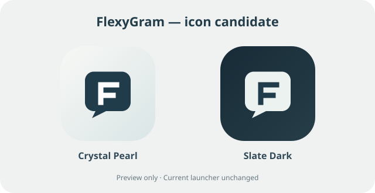

# FlexyGram — PR de marca visible e icono candidato

Proyecto FlexyGram 1.0, dirigido por @Lukhou23. Rama auxiliar basada en develop `ab063041804674861e865364206c0ef27ef1e953`. Cambios únicamente de recursos y pruebas, independientes de P0.4c (JNI, Python y compatibilidad nativa).

## Cambios realizados

- Los recursos **AppName** y **AppNameBeta** pasan a **FlexyGram** y **FlexyGram Beta** en los ocho archivos `strings.xml` que los definían: values base, ar, de, es, it, ko, nl y pt-rBR. La etiqueta principal de Diagnostic continúa siendo **FlexyGram Diagnostic**.
- La etiqueta de AccountManager utiliza `@string/AppName`; adopta el nombre nuevo sin editar ni habilitar servicios del autenticador.
- **Icono candidato sin activar**: `ic_launcher_flexygram_candidate` (adaptativo y circular), un monograma F dentro de una burbuja original en acabado perlado sobrio, versión oscura y capa monocromática. No copia el logotipo de Telegram ni exige recursos binarios de terceros. Es una propuesta para aprobación visual; no se sustituye el lanzador, ni las variantes alternativas.
- Los nombres de paquetes, clases `org.telegram.*`, `app.exteraless.*` y el alias interno `ExteralessIcon` permanecen sin cambios. Conservarlos preserva enlaces, JNI, widgets, compatibilidad y créditos originales.

### Vista previa del candidato



La vista previa reproduce los colores y la geometría de los recursos vectoriales propuestos, pero no sustituye una prueba AAPT2 ni una captura de Android.

## Alcance exacto y decisiones aplazadas

- No se modifican manifiestos, Gradle, políticas Java/JNI, minSdk, Chaquopy, servicios, firmas, autenticación ni código productivo.
- El icono efectivo en Diagnostic **sigue siendo Exteraless** hasta una aprobación específica del nuevo diseño.
- Los nombres de la biblioteca de terceros y créditos se conservan. `AppUpdateBeta` aún contiene una referencia a Telegram Beta, pero su semántica de actualización requiere una revisión separada de consumidores antes de cambiarlo; no se renombra automáticamente.
- Los recursos de otros locales sin redefinición propia de AppName o AppNameBeta heredan de values. Si se añaden nuevas traducciones, deben revisarse de nuevo.
- El archivo `settings.gradle` sigue con `rootProject.name = "exteraless"`: nombre interno de construcción, no la etiqueta visible; cambiarlo podría afectar rutas o tooling y se evaluará con Work.
- El candidato solo proporciona capas adaptativas para API 26+; ninguna variante heredada de icono redondo/legacy queda eliminada. La selección definitiva necesita revisión del soporte de launchers y de recursos pre-26.

## Comprobación y pendientes

Pruebas añadidas: `tests/brand_resources/test_branding.py` (seis pruebas de XML/etiquetas/recursos/conservación del launcher). Ejecutar desde la raíz:

```sh
python -m unittest discover -s tests/brand_resources -v
```

Revisiones estáticas con el conector GitHub: los 8 archivos de strings contienen exactamente los dos valores de marca esperados; los iconos vectoriales y los dos mipmaps candidatos están presentes. Las comprobaciones de texto **no** acreditan la validez completa de los XML, ni una compilación de recursos Android.

**La suite Python, AAPT2 y Gradle completo todavía deben ejecutarse en un checkout con SDK por Work**. No declarar resultados que no se hayan ejecutado, ni instalar/publicar APK por este PR. Work también deberá revisar las referencias localizadas, los accesos directos y notificaciones antes de elegir el nuevo icono.

No fusionar este PR por encima de cambios nativos P0.4c sin revisar el diff. Mantener `main` intacta, `production` bloqueada, PR #2 abierto, Actions sin activar y todo el trabajo de Work intacto.
