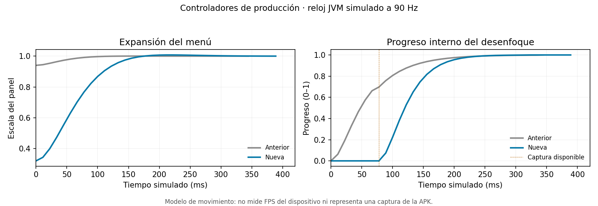

# Beta 43 — movimiento de mensajes y fotos

Preparación `1.0.0-beta.43`, build `1332`, sobre `912ef3b1386012dd491bad771db55154629aedac` de `codex/flexygram-beta-glass`. Incluye las optimizaciones de beta 42. **Sin compilar una APK ni iniciar GitHub Actions**.

## Referencia y resultado buscado

Se revisó el video facilitado por el propietario: unos 13,05 segundos de interacción con mensajes y fotos, con menús contextuales y reacciones. El archivo tiene timestamps variables y una media de aproximadamente 88,6 imágenes por segundo; esto no identifica por sí solo la frecuencia ni el rendimiento del dispositivo.

El patrón observado es una elevación discreta de la selección, expansión del menú desde su anclaje, aparición coordinada de reacciones y retorno amortiguado. Los parámetros se adaptaron al menú actual de FlexyGram mediante análisis visual; no se han obtenido las curvas internas de la aplicación del video.

## Cambios aplicados

- **Expansión visible y anclada.** El menú comienza al 32 % de su escala y alcanza el tamaño final con un rebote pequeño. Antes empezaba al 94 %, por lo que casi toda su geometría aparecía ya extendida. Conserva el anclaje existente según el mensaje entrante/saliente y la presentación elegida para las acciones.
- **Elevación ligera de la selección.** El resorte de la burbuja apunta a `1.012`, en vez de permanecer a escala 1. La imagen, texto, caption y hora mantienen su transformación conjunta. El ajuste de fotos altas continúa limitando la escala para respetar el viewport y el espacio de las reacciones.
- **Tiempo físico consistente.** Se añade `Spring.stepExact`, una solución analítica del resorte amortiguado para estas interacciones. Se conserva `step()` para los demás consumidores, incluidos los controles musicales. La trayectoria usa el tiempo real transcurrido entre frames; no adelanta un sub-frame fijo al abrir ni mueve hacia atrás su reloj cuando el primer timestamp precede al gesto dentro del mismo vsync.
- **Desenfoque que comienza cuando hay imagen.** El progreso del blur permanece en cero hasta que llega la captura y entonces inicia su fundido. Antes avanzaba aun sin bitmap, permitiendo que una captura tardía apareciera con una opacidad ya alta. La captura inmediata anterior a `enter()` se conserva y se activa después de establecer el propietario. Las generaciones obsoletas, ventanas cerradas y retornos en curso siguen descartándose.
- **Retorno continuo e interrumpible.** Cerrar cambia el objetivo manteniendo posición y velocidad. El menú, la burbuja y las reacciones siguen un mismo `SelectedBubbleMotion`; el fondo tiene su estado de disponibilidad/fundido dentro de ese propietario. Un nuevo gesto conserva la limpieza inmediata y el cierre no bloquea el scroll.
- **Sin corte fijo de 250 ms en el resorte de compatibilidad.** `BubbleTapMotion` consume el nuevo integrador hasta asentarse. Los handlers de celdas siguen sin arrancarlo en DOWN/MOVE: deslizar la conversación no pone a oscilar las filas.

Se mantienen los iconos, diseños de burbujas y menú, fuentes, portada del reproductor, estilo de blur/glass y políticas de ahorro. Los taps normales de foto/vídeo conservan su acción nativa. La animación descrita pertenece al menú de interacción Signature; se conserva la selección explícita del estilo clásico.

## Duración y límites

En el muestreo del controlador real con reloj JVM simulado, el menú nuevo alcanza una escala máxima aproximada de **1,0075** y se asienta entre **382 y 400 ms** para los intervalos ensayados. La mayor parte de la expansión termina antes. El cierre desde reposo termina aproximadamente entre **175 y 200 ms**; un cierre interrumpido tiene una salvaguarda de 260 ms. Los límites no introducen esperas mínimas ni retrasan la acción del usuario.

Se sigue usando el reloj local de frames, independiente del multiplicador global ×0,01 y de las escalas del teléfono. Se conservan el apagado explícito de animaciones de Telegram y el comportamiento de accesibilidad: al desactivar ese movimiento, se aplica el estado final directamente.

El integrador trabaja con valores numéricos, sin objetos por paso. Permanece una única captura por apertura y un callback de frames por propietario, con cancelación y finalización una sola vez. No se añade decodificación de imagen, reconstrucción de layouts ni un segundo animator en cada frame.

## Validación

**386 pruebas correctas, 39 omitidas** por corpus/dependencias opcionales no disponibles.

Las pruebas nuevas ejecutan el código de producción con dobles explícitos del reloj, ventana, entrega de bitmaps y servicios:

- Mismo estado a igual tiempo transcurrido con 30/60/90/120/144/240 Hz y con pasos irregulares; también se ejercitan resortes subamortiguados, críticos y sobreamortiguados.
- Primera entrega con un timestamp anterior al instante de entrada, sin adelantar el recorrido.
- Cierre que conserva posición/velocidad, cambios repetidos de propietario, finalización única y ausencia de callbacks en reposo.
- Captura de blur tardía después de asentarse el menú: inicia en cero, progresa sin reiniciar la geometría y no crea un segundo callback si se anuncia dos veces.
- Captura inmediata conservada antes de crear el propietario; resultados obsoletos o entregados durante el cierre descartados.
- Gestos nativos, cancelación por scroll, límites de fotos altas y coordinación de la ventana existentes.

Las cuatro clases de movimiento también pasan la verificación aislada contra un **Android API 35 real**, con el gate de preferencias como doble. No equivale a compilar toda la aplicación con API 37 ni a observar su comportamiento en un dispositivo.

La revisión de sintaxis de los archivos Java modificados y `git diff --check` son correctos. Las asociaciones, fuentes y hashes de los iconos se verifican con el generador existente.

## Muestras reproducibles

[Datos numéricos](beta43-motion.json) del controlador anterior y el actual, junto a su reloj simulado. La columna de blur representa su progreso interno; antes de llegar la captura no hay un bitmap visible. La gráfica no es una captura de la APK ni una medición de FPS.



```sh
python -m pytest tests/ -q -p no:cacheprovider
python tools/native_context/sample_menu_motion.py --output /tmp/menu-motion.json
python tools/native_context/check_motion_types.py --android-jar /path/to/android.jar
```

El comparador requiere el commit base en el historial Git. Queda la comprobación visual en dispositivo de mensajes, fotos/álbumes, blur/glass, cambios de tema, teclado y aperturas/cierres rápidos. No se certifica igualdad de píxeles con el video ni una tasa de frames del teléfono.

## Integridad de identidad

Se restauró en `AGENTS.md` la transcripción original de la huella del certificado, alterada al sustituir numéricamente la versión en una revisión anterior. Los incrementos de esta entrega se limitan a los campos de versión. No se han cambiado claves, configuración de firma ni paquete de la aplicación.
