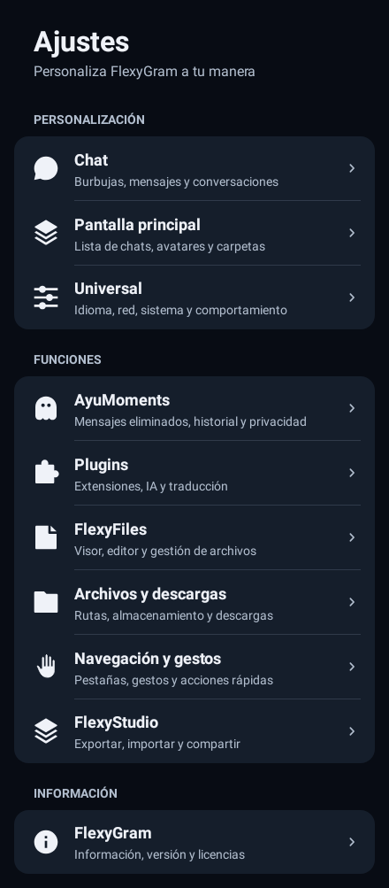
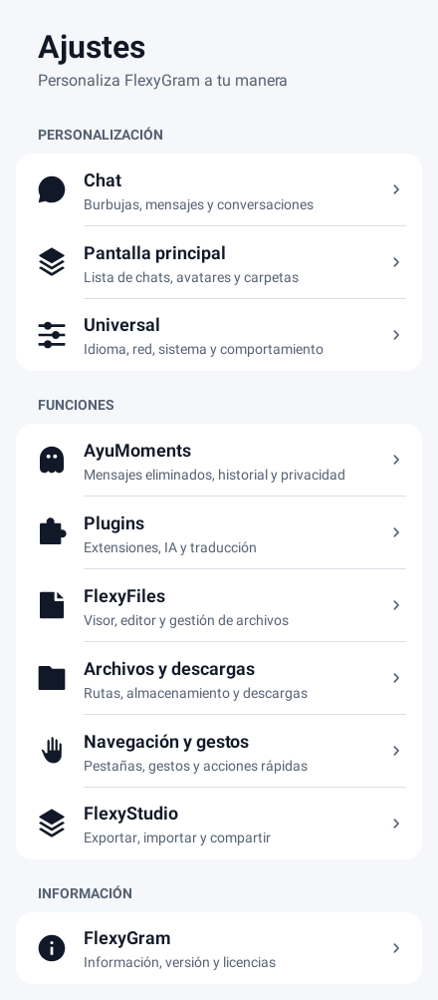

# Signature Settings 3.0 — draft integration

Approved references: `51674.png` light and `51673.png` dark (received as `51674(1).png` and `51673(1).png`). These replace the colored Settings2 presentation. No new mockups were generated.

Base: PR161 `feat/beta-official-source-v2`, `3c7a20a229d425c8f3b5ea1740ccb6d8b3361fea`. This includes the merged PR160 plus Work1's settings recycling and official Beta fixes. The older PR141 branch currently points to an earlier commit, so using it would discard integrated work. The independent feature branch preserves PR161's app behavior and does not change main, signing, version, identifiers or distribution.

## Implemented

- Exactly ten root entries in the approved three groups. The obsolete eight-entry hub remains only as an internal search/alias catalog, not the displayed settings root.
- Same VectorDrawable resources for light/dark, tinted from Telegram's foreground color. No colored tiles, gradients, Glass, shadows, animation engine or idle work is introduced.
- Chat: original Header preview/controls, Bubble preview/controls, Composer preview/controls, original message/menu/media/sticker rows and remaining extra ConfigCells. One RecyclerListView, no nested fragment/list views. Existing context style and delete selector are direct controls; the original sticker toolbar reset is also available as a direct row.
- Home: existing layout, avatar, folder, visibility and smart preview controls in one list.
- Universal: existing general/network/maps/push/profile/archive, fonts/effects, residual technical preferences and the original launcher selector. No stored keys are migrated.
- AyuMoments: original GhostMode rows and AyuMoments controller in one page; the former ghost navigation row is hidden only for this embedded presentation.
- Navigation: BottomTabs, the original simple tablet/back/drawer controls, gesture rows and residual navigation options directly available. The specialized reorder editor omits these simple controls to avoid duplication.
- FlexyFiles: existing local opt-in/help only. Files and downloads: original save-path/per-chat folder handlers only. Studio retains export/import/share.
- Plugins, AI, translator, icon/emoji pack management, cloud/passcode and menu reordering retain specialized managers where their workflows require them. These are not new settings backends.
- Original row sharing/long-press and search/deep-link routing dispatch through local row coordinates to canonical categories.

## Architecture and risks

`NativeSettingsSection` is a row contribution interface implemented by the existing Neko base controllers. It does **not** call child `createView`, add child fragments to navigation, or create child scrolling surfaces. It initializes the original adapter/callbacks with the current account and theme, exposes the host view for existing dialogs/bulletins and forwards pause/resume/destroy and activity/permission results. Each controller retains its own request GUID and dialog lifecycle.

`NativeSectionsAdapter` isolates view types per section. An outer holder retains the original inner holder/type to avoid cross-section casts. Original position-dependent enabled predicates use a local position helper. Adapter notifications, click/long-click and deep-link scroll positions translate to the shared list. Disposal detaches the adapter, unregisters observers, cancels original controller resources and rejects late notifications.

Existing preference callbacks remain intact. The four simple navigation callbacks were extracted to a **single shared implementation**, used by both presentations. It deliberately preserves original behavior, including existing restart/rebuild requirements; this feature does not promise impossible instant refreshes or change global animation behavior.

**This controller composition needs full integration/lifecycle validation.** The isolated probe compiles/renders the root and tests the real AndroidX composition adapter, but doubles the Telegram host and legacy controllers. It does not compile or execute the complete direct-category controller or the two modified Neko bases. Syntax parsing is not semantic compilation. Do not infer release readiness from isolated tests.

## Visual evidence

These are real Android Canvas renders of production root/cell/vector code. Toolbar/list hosting is a double; screenshots show content only. No synthetic Chat previews are presented as implemented-device screenshots. Full-app Chat/Home/Universal/navigation captures remain required.

## Next acceptance gate

See [VALIDATION.md](VALIDATION.md) and [MIGRATION.md](MIGRATION.md). Keep this PR in draft until the integrated build, actual settings interactions/persistence and device acceptance pass. No APK is generated by this work.
