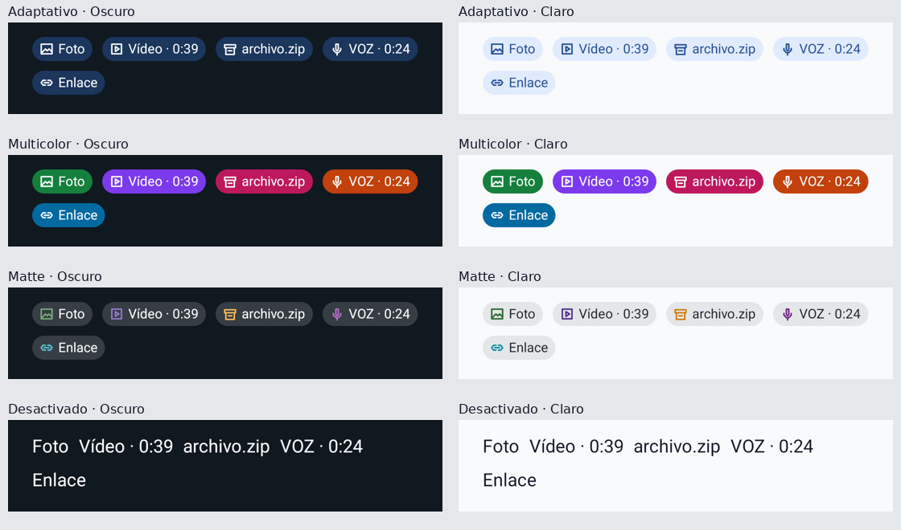

# Signature Smart Previews 2.0

Base Beta/Settings3: `4679f74ebd312acc4968dd2e044a6c6b7478445a`.
Validated executable source: `9643d6b3d37e50fbe1c918b0d1126ecae099d432`.

**FlexyGram → Pantalla principal → Mini píldoras** now embeds four native radio rows and one compact local demonstration in the same scrolling list. There is no second visible legacy picker.

| Style | Behavior |
| --- | --- |
| Adaptativo | Accent/surface from the current Theme.ResourcesProvider, contrast-derived text |
| Multicolor | Solid category colors; new default only when no palette was saved |
| Matte | Original colors/behavior preserved exactly |
| Desactivado | Original native preview text/layout; no reserved pill gap |

`flexy_signature_smart_previews/palette` is retained: saved 0/2/3 remain, old Theme/Accent 1 migrates to Adaptive 0, and Multicolor uses 4. Search and old route `flexySmartPreviews` reach Home. The existing classifier, protected-content gates, snippets, thumbnails and native message processing are unchanged.

Photos/image files use `#15803D`, videos/GIF `#7C3AED`, documents/files `#2563EB`, ZIP/RAR/archives `#BE185D`, audio/voice `#C2410C`, links `#0369A1`. Existing contact/location/event/role kinds use stable complementary colors. No filename-based randomness, Glass, blur, shimmer or decorative animation is added.

## Renderer evidence

[Eight full-resolution component renders](renders/) come from **production SmartPreviewsDemoView, SignatureSmartPillSpan, icon and palette**, drawn with Android native graphics under Robolectric API35. These are **not screenshots of the integrated Telegram app or the Poco**. Theme/service/controller hosts are explicitly doubled; the AndroidX RecyclerView implementation and its linked AAR resources are real. Original source images are unmodified; the comparison scales and places them alongside labels.

## Verified

- 156 general tests passed, 31 optional skips; 12 settings ownership/regression checks passed.
- Six focused host tests: classifier/text preservation, identity/protocol preservation, selector ownership, lifecycle, draw-path checks and palette behavior.
- Eleven Android tests: real preference reload/migration, four selections, theme/provider changes, production adapter selection notifications, native rendering, bounds/long filename/RTL, per-span typography, listener disposal and 1,000 warm demo draws.
- Ten existing Settings3 Android regressions passed.
- Palette comparison retained Matte exactly for 300 theme pairs and all 33 existing kinds; category colors/opaque backgrounds and text contrast >= 4.5 checked.
- 100,000 warmed pure-Java palette resolutions allocated **0 bytes in HotSpot**. This is **not** Android ART, FPS, jank or physical memory evidence.
- [Final renderer CI](https://github.com/Jose22Yt/FlexyGram/actions/runs/41356172560). Artifact identity/hashes: [evidence.json](evidence.json).

Color-only changes invalidate subscribed visible pill rows and retain their StaticLayout. OFF transitions rebuild only potentially affected attached message rows through the original buildLayout. Listener ownership is attach/detach. No global dialogs reload, dataset reset, per-frame layout/font loading, or preview network/file work is introduced.

## Remaining acceptance gates

Full integrated Beta compilation, real DialogCell/recycler/theme/account/message-arrival scenarios, cold-process preference persistence and physical Poco X8 Pro / Android17 / HyperOS4 scroll, ART memory and frame traces remain **NOT TESTED**. Local Gradle distribution download was blocked (`Network is unreachable`); remote Gradle dry-run graphs are not compilation evidence.

The general release workflow remains blocked by the frozen Beta scope review, reproduced on a pristine base as well as this candidate. The candidate also adds its new review scope. [Baseline comparison](baseline-comparison.json). Release contracts/manifests, signing, identity and credentials remain unchanged; the guard was not bypassed. No APK was generated or published by this work.

Reproduce: `python tools/smart_previews2/checks.py`, `python -m pytest tests -q`, `python tools/settings2/checks.py`, and `python tools/smart_previews2/android/run.py --sdk-root "$ANDROID_HOME" --output-dir build/smart-previews2-android` (JDK21, Maven, API37/build-tools36 required).
